# Freelance Client Onboarding & Qualification Toolkit

[](LICENSE)
[](calculators/freelance-floor-rate-calculator.py)

A free, openly licensed collection of standard operating procedures, client intake questionnaires, onboarding checklists, and floor-rate pricing calculators for freelance developers, technical contractors, and solo digital agencies.

Designed to stop unpaid discovery, eliminate scope creep, qualify inbound clients, and establish professional client onboarding workflows.

---

## Shop and portfolio

Business and freelancer templates by Ahmed Fouad (Excel, Word, PDF, Notion). The kits below are sold on Gumroad; every preview image is a real page or sheet from the delivered files.

**Contact: hermes.soulmate@gmail.com**

### Freelance Client Onboarding Toolkit ($12) - Excel + Word + PDF
22-page PDF guide, an Excel workbook (rate calculator, project quote builder, retainer builder, outreach tracker, 48-service list) and three editable Word files (service menu, outreach scripts, onboarding and contract checklists).
Buy: [fouaad.gumroad.com/l/pmnhvv](https://fouaad.gumroad.com/l/pmnhvv) - Notion edition: [Notion Marketplace](https://www.notion.com/templates/freelance-va-starter-toolkit)

| 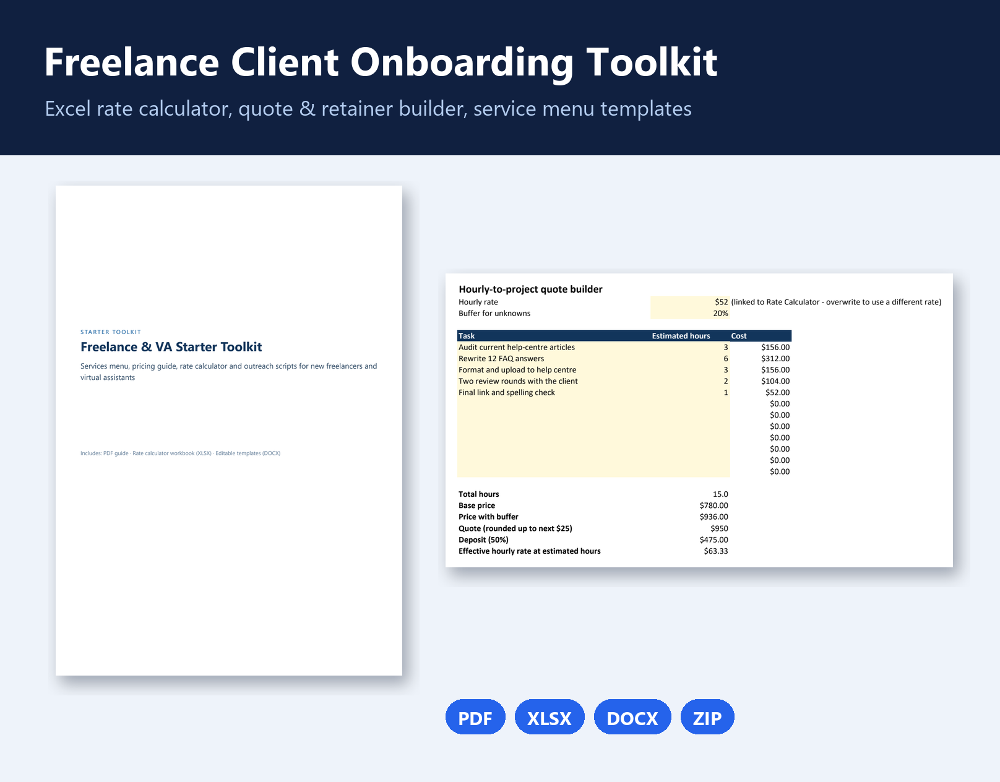 | 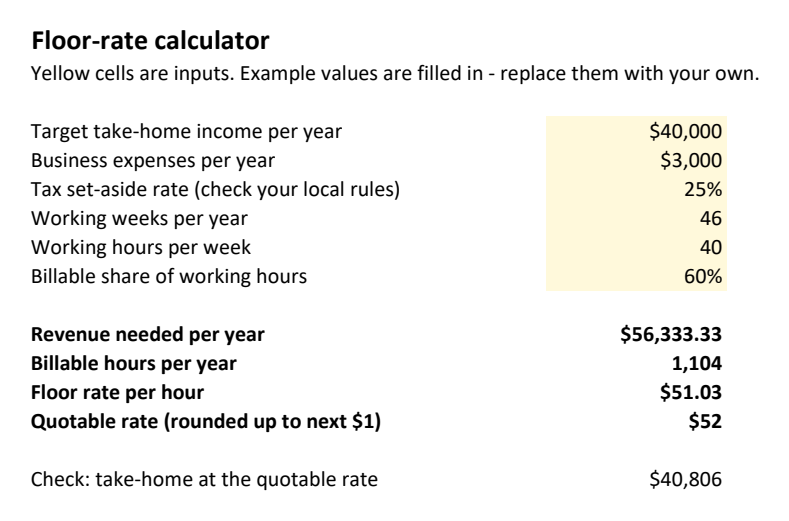 | 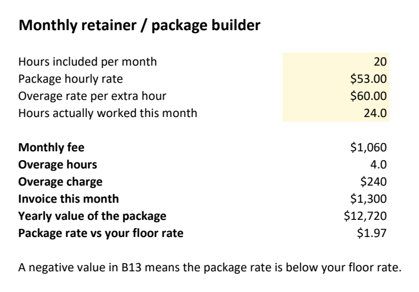 | 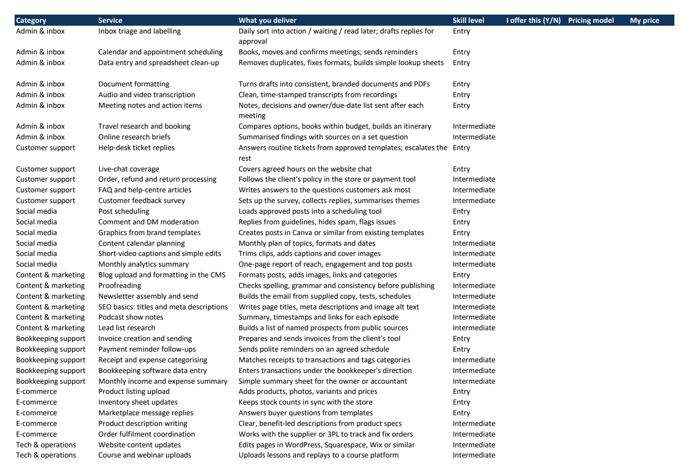 |
|---|---|---|---|

### Client Onboarding & Operations Kit for Solo Devs ($9) - PDF + SOP templates
8-page PDF manual plus templates: client intake SOP, MSA/SOW starter contracts, 72-hour onboarding workflow, AI prompt library, delivery sign-off protocol and a pipeline/margin calculator.
Buy: [fouaad.gumroad.com/l/zbarfx](https://fouaad.gumroad.com/l/zbarfx) - [Indie Hackers product page](https://www.indiehackers.com/product/solopreneur-ai-operations-kit)

| 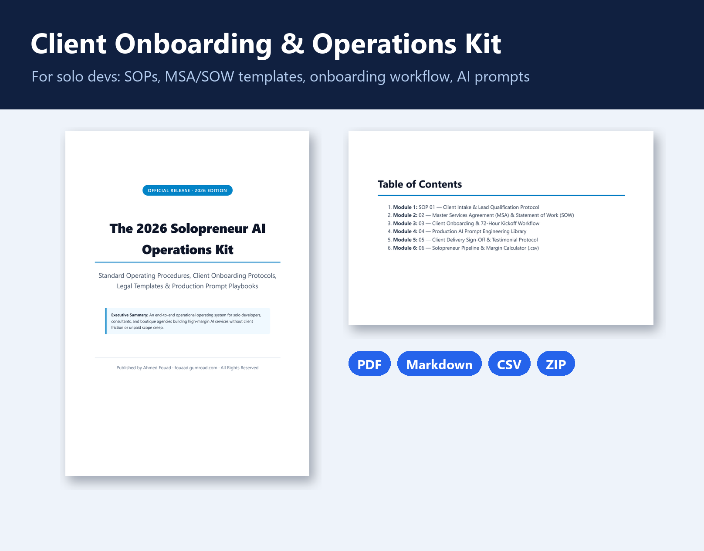 | 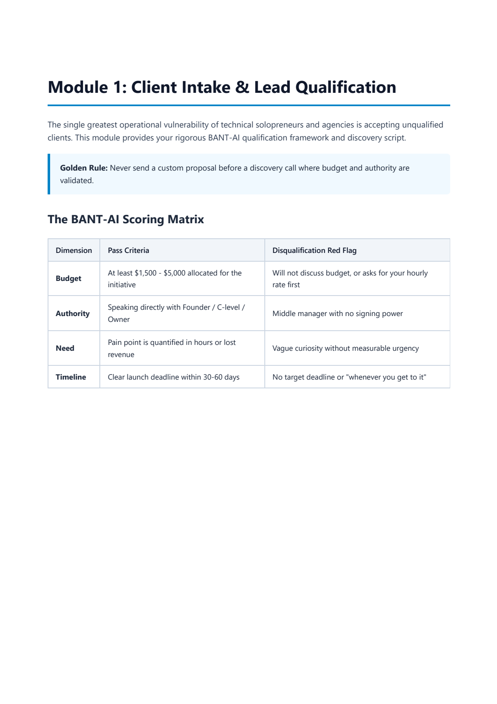 | 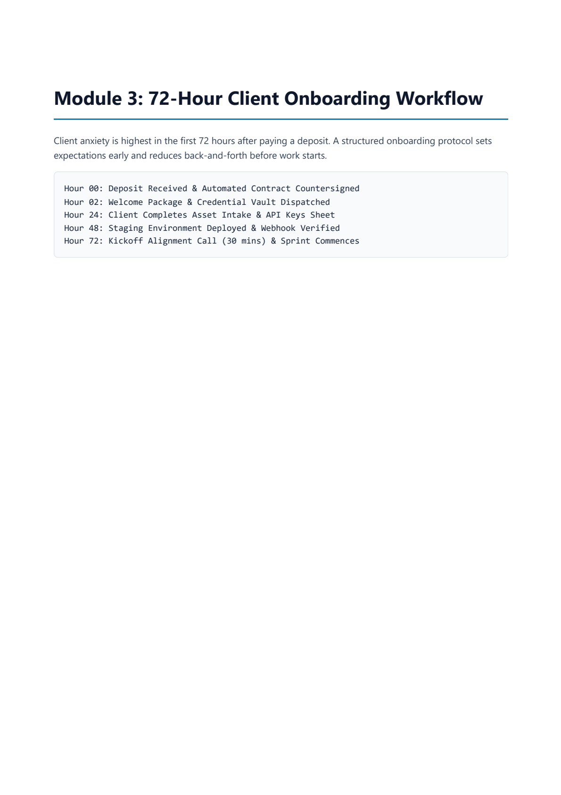 | 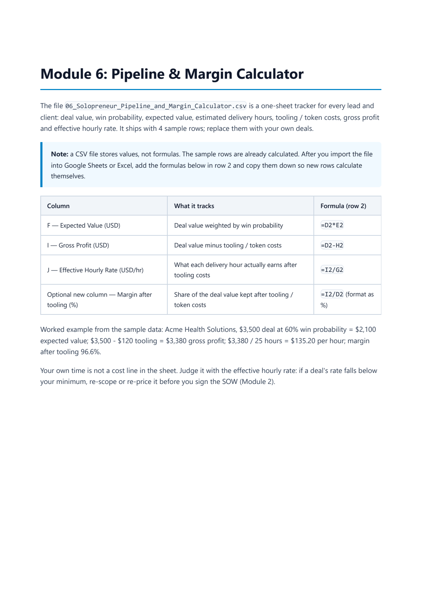 |
|---|---|---|---|

### Project Planning Workbook ($7) - Excel + printable PDF
15-page printable PDF and a 10-sheet Excel workbook: goal, time blocks, budget with expense log, WORKDAY milestone timeline, tasks with dependencies, resources, risk register and review.
Buy: [fouaad.gumroad.com/l/zmpbo](https://fouaad.gumroad.com/l/zmpbo)

| 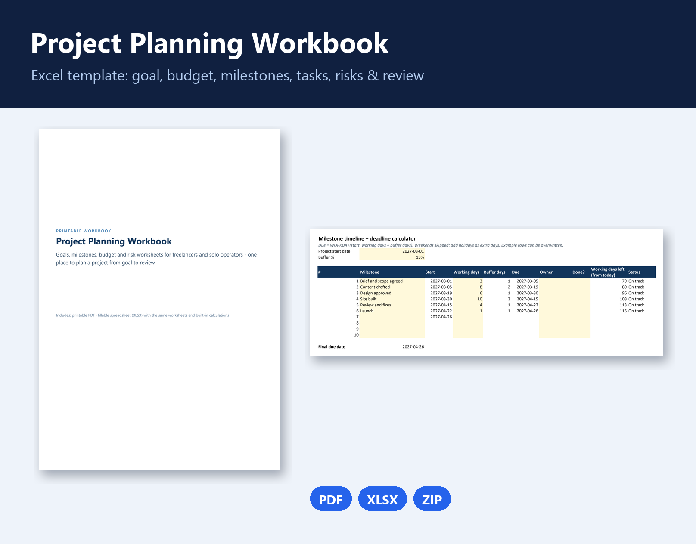 | 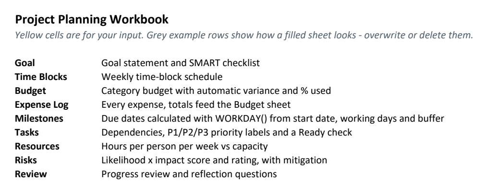 | 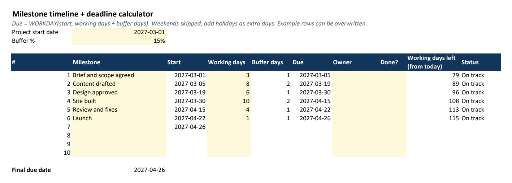 | 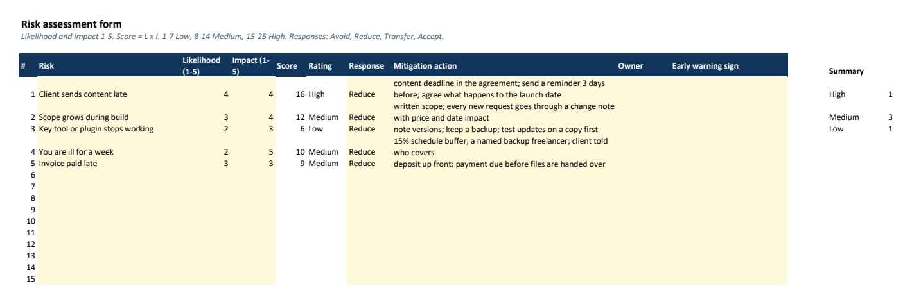 |
|---|---|---|---|

Also: [Contract & Pricing Starter Kit ($3)](https://fouaad.gumroad.com/l/pfoww). Full shop: **[fouaad.gumroad.com](https://fouaad.gumroad.com)**.

Made with AI assistance: the guides, templates, spreadsheets and cover layouts were drafted with AI tools and reviewed by the maintainer. Templates are general guidance, not legal advice. The preview images and paid kits are not covered by this repository's CC BY 4.0 licence.

---

## What's Included

### 1. [Client Intake & Qualification SOP](sop/client-intake-and-qualification-sop.md)
- **The BANT-AI Framework:** A structured 4-pillar qualification scoring system (Budget, Authority, Need, Timeline & Tech readiness) to vet inbound leads before scheduling calls or drafting proposals.
- **20-Minute Discovery Call Script:** 8 high-leverage questions to uncover business pain points, quantifiable ROI, and decision-maker consensus.
- **Red Flag Checklist:** 6 warning signs to disqualify high-risk, low-budget, or scope-creeping clients before work starts.
- **AI Lead Pre-Scoring Prompt:** Copy-paste prompt for LLMs (ChatGPT, Claude, Gemini) to give inbound inquiries a consistent first-pass score (always review the result yourself).

### 2. [Client Kickoff & Onboarding Checklist](checklists/client-kickoff-checklist.md)
- A 5-phase structured onboarding roadmap covering:
  1. Pre-Contract Qualification & Scope Alignment
  2. MSA, Statement of Work (SOW) & Upfront Deposit Collection (50% upfront standard)
  3. Secure Access Provisioning (GitHub, Cloud, Databases, API keys, Staging envs)
  4. 30-Minute Kickoff Alignment Meeting & SLA Confirmation
  5. Delivery Milestones, Formal Acceptance Sign-Off & Review Gathering

### 3. [Project Scope & Discovery Questionnaire](templates/project-scope-questionnaire.md)
- A ready-to-send intake questionnaire for prospective clients covering business objectives, technical architecture, third-party integrations, timelines, and budget bands.

### 4. [Freelance Floor Rate & Fixed-Price Calculator](calculators/freelance-floor-rate-calculator.py)
- Interactive CLI Python tool to calculate:
  - True billable hours after accounting for non-billable overhead, admin, and time off
  - Required gross revenue to hit net income targets after taxes and business expenses
  - Minimum hourly floor rate, day rate, and monthly retainer targets
  - Fixed-price project quoting with configurable scope contingency buffers (20–30%)

```bash
# Run the calculator
python calculators/freelance-floor-rate-calculator.py
```

---

## Upgrades & Full Template Kits

If you need complete, editable contracts, spreadsheets and workbooks, see the paid kits with previews in [Shop and portfolio](#shop-and-portfolio) (optional; everything in this repo is free to use).

---

## License & notes

Text and templates in this repository are licensed under [Creative Commons Attribution 4.0 International (CC BY 4.0)](LICENSE): use, adapt and share them, including commercially, with attribution.

- These templates are general business guidance, not legal, tax or financial advice. Have contracts reviewed for your jurisdiction.
- Dollar ranges and rates are illustrative examples; set your own from your market.
- Drafted with AI assistance and reviewed by the maintainer.
